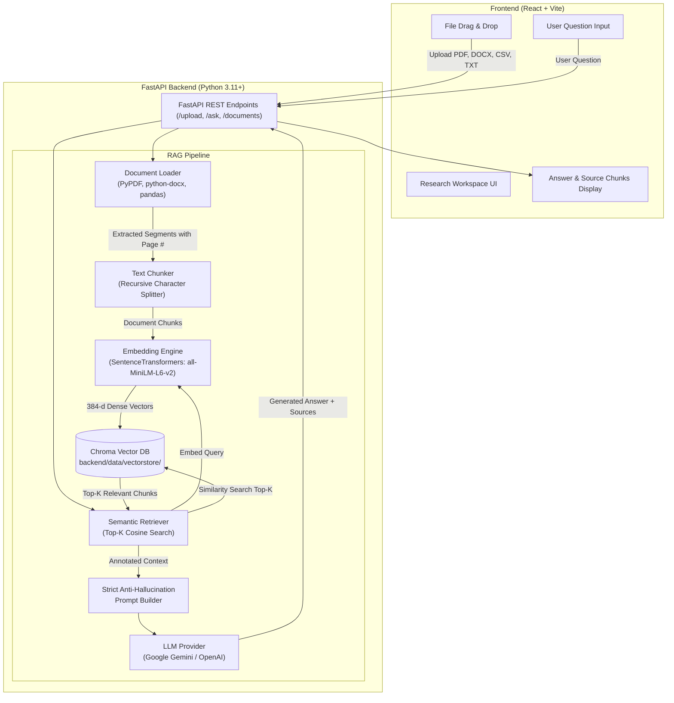

# macOS RAG Research Workspace

A complete, production-ready **Retrieval-Augmented Generation (RAG) Document Question-Answering Application** tailored specifically for macOS (Apple Silicon and Intel architectures).

The application allows researchers, students, and engineers to upload diverse document types (PDF, Word DOCX, CSV tables, Markdown, and TXT), extracts and chunks text while maintaining page and section provenance, indexes embeddings into a local persistent Chroma vector database, and generates verifiable, anti-hallucinatory answers powered by configurable LLMs (Google Gemini or OpenAI).

---

## Architecture Diagram



---

## 1. Project Overview

The **macOS RAG Research Workspace** is designed from the ground up to solve the common issues with RAG prototypes:
- **No Hallucinations**: Prompt instructions strictly enforce that the LLM must answer *only* using retrieved evidence and output a clear refusal (*"I could not find this information in the uploaded document."*) if the information is missing.
- **Verifiable Citations**: Every generated response includes the exact retrieved source chunks with **page numbers** (for PDFs), headings (for DOCX/Markdown), or row batches (for CSV). Clicking any citation expands the verbatim chunk text.
- **Local Privacy**: Document text and embedding vectors are stored locally on your Mac in `backend/data/`.
- **Hardware Acceleration**: Dynamically leverages Apple Silicon Metal Performance Shaders (MPS) where available.
- **Multi-Document Support**: Upload multiple documents, switch between them, or query across the entire corpus.

---

## 2. Code File Directory & Responsibilities

The codebase cleanly separates concerns across services:

| Component | Responsible File | Purpose |
| :--- | :--- | :--- |
| **Document Loading** | [`backend/app/services/document_loader.py`](file:///Users/shubham/.gemini/antigravity/scratch/rag-macos/backend/app/services/document_loader.py) | Validates files, cleans text, extracts text per page/section from PDF, DOCX, CSV, and TXT. |
| **Chunking** | [`backend/app/services/chunker.py`](file:///Users/shubham/.gemini/antigravity/scratch/rag-macos/backend/app/services/chunker.py) | Recursively splits text into chunks (`CHUNK_SIZE`, `CHUNK_OVERLAP`), attaches chunk IDs, page numbers, and provenance. |
| **Embeddings** | [`backend/app/services/embeddings.py`](file:///Users/shubham/.gemini/antigravity/scratch/rag-macos/backend/app/services/embeddings.py) | Generates dense 384-dimensional vector embeddings locally using `sentence-transformers/all-MiniLM-L6-v2`. |
| **Vector Storage** | [`backend/app/services/vector_store.py`](file:///Users/shubham/.gemini/antigravity/scratch/rag-macos/backend/app/services/vector_store.py) | Persistent Chroma storage in `backend/data/vectorstore/`, multi-document filtering, cosine distance search. |
| **Retrieval** | [`backend/app/services/retriever.py`](file:///Users/shubham/.gemini/antigravity/scratch/rag-macos/backend/app/services/retriever.py) | **Exact location where retrieval happens**: Embeds user query, queries Chroma for top-k chunks, and structures prompt context. |
| **Prompt Construction** | [`backend/app/services/retriever.py`](file:///Users/shubham/.gemini/antigravity/scratch/rag-macos/backend/app/services/retriever.py) & [`llm_service.py`](file:///Users/shubham/.gemini/antigravity/scratch/rag-macos/backend/app/services/llm_service.py) | Formats annotated context blocks with document titles and page citations into the strict anti-hallucination system prompt. |
| **LLM Response** | [`backend/app/services/llm_service.py`](file:///Users/shubham/.gemini/antigravity/scratch/rag-macos/backend/app/services/llm_service.py) | Configurable execution for Google Gemini (`gemini-1.5-flash`) and OpenAI (`gpt-4o-mini`). Includes keyless test fallback. |
| **Source / Citation** | [`backend/app/routes/api.py`](file:///Users/shubham/.gemini/antigravity/scratch/rag-macos/backend/app/routes/api.py) & [`SourceCard.jsx`](file:///Users/shubham/.gemini/antigravity/scratch/rag-macos/frontend/src/components/SourceCard.jsx) | Extracts page numbers, relevance percentages, chunk IDs, and returns structured citation JSON to the frontend. |
| **Document State** | [`backend/app/services/document_manager.py`](file:///Users/shubham/.gemini/antigravity/scratch/rag-macos/backend/app/services/document_manager.py) | Manages metadata in `backend/data/documents_metadata.json` so indexed documents persist across app restarts. |

---

## 3. Folder Structure

```
rag-macos/
├── backend/
│   ├── app/
│   │   ├── main.py                  # FastAPI application entry point & CORS
│   │   ├── config.py                # Environment configuration & paths
│   │   ├── routes/
│   │   │   └── api.py               # REST endpoints (/upload, /ask, /documents, /health, /settings)
│   │   └── services/
│   │       ├── document_loader.py   # PDF, DOCX, CSV, TXT parser
│   │       ├── chunker.py           # Recursive text chunking with metadata
│   │       ├── embeddings.py        # SentenceTransformers local model
│   │       ├── vector_store.py      # Chroma vector DB operations
│   │       ├── retriever.py         # Semantic retrieval coordinator
│   │       ├── llm_service.py       # Gemini / OpenAI LLM integration
│   │       └── document_manager.py  # Metadata persistence across restarts
│   ├── data/
│   │   ├── uploads/                 # Saved uploaded original documents
│   │   ├── vectorstore/             # Chroma persistent vector database
│   │   └── documents_metadata.json  # Saved document records
│   ├── requirements.txt             # Python dependencies
│   ├── test_rag_pipeline.py         # Complete end-to-end verification test suite
│   └── create_sample_docs.py        # Generates test sample documents
│
├── frontend/
│   ├── src/
│   │   ├── main.jsx                 # React root
│   │   ├── App.jsx                  # Main Research Workspace UI
│   │   ├── index.css                # macOS modern dark styling & glassmorphism
│   │   └── components/
│   │       ├── Sidebar.jsx          # Document library, multi-select, delete
│   │       ├── SourceCard.jsx       # Expandable citation card with page badges
│   │       ├── UploadModal.jsx      # Drag & drop upload with progress states
│   │       └── SettingsModal.jsx    # Top-K slider, chunk settings & API keys
│   ├── index.html                   # HTML entrypoint
│   ├── vite.config.js               # Vite config & API reverse proxy
│   └── package.json                 # Frontend dependencies
│
├── sample_documents/                # Pre-generated sample documents for testing
│   ├── Research_Paper.pdf           # 4-page research paper
│   ├── Project_Specifications.docx  # Multi-section Word document
│   ├── benchmarks_dataset.csv       # Tabular benchmark metrics
│   └── anti_hallucination_guidelines.md
│
├── .env                             # Environment configuration (active)
├── .env.example                     # Example environment template
├── start.sh                         # Unified startup script for macOS
└── README.md                        # Documentation
```

---

## 4. System Requirements

- **Operating System**: macOS (tested on macOS 14 Sonoma / macOS 15 Sequoia on Apple Silicon M1/M2/M3/M4 or Intel).
- **Python**: Python 3.11+ (recommended `/opt/homebrew/bin/python3.11`).
- **Node.js**: Node.js 18+ or 20+ and `npm`.

---

## 5. Installation

### Quick Automated Start
From the project root directory, run:
```bash
chmod +x start.sh
./start.sh
```
`start.sh` will automatically create the Python virtual environment, install requirements, install frontend packages, start both services, and launch on `http://localhost:5173`.

---

### Manual Step-by-Step Installation

#### 1. Backend Setup
```bash
cd backend
python3.11 -m venv venv
source venv/bin/activate
pip install -r requirements.txt
```

#### 2. Frontend Setup
```bash
cd ../frontend
npm install
```

---

## 6. Environment Variables

Create your `.env` file in the project root or `backend/`:
```bash
cp .env.example .env
```

Configurable keys:
```env
# LLM Provider ("gemini" or "openai")
LLM_PROVIDER=gemini

# Google Gemini API Key (Recommended)
# Get a free API key at: https://aistudio.google.com/app/apikey
GEMINI_API_KEY=your_gemini_api_key_here
GEMINI_MODEL=gemini-1.5-flash

# OpenAI API Key (Optional Fallback)
# OPENAI_API_KEY=your_openai_api_key_here
# OPENAI_MODEL=gpt-4o-mini

# Retrieval Hyperparameters
TOP_K=5
CHUNK_SIZE=800
CHUNK_OVERLAP=100
EMBEDDING_MODEL=all-MiniLM-L6-v2
```

> **Note**: Even if no API key is provided, the application runs in **Local Retrieval Mode**, accurately retrieving relevant document passages and displaying citations.

---

## 7. How to Start Backend

```bash
cd backend
source venv/bin/activate
uvicorn app.main:app --host 0.0.0.0 --port 8000 --reload
```
FastAPI Interactive Swagger Docs: `http://localhost:8000/docs`

---

## 8. How to Start Frontend

```bash
cd frontend
npm run dev
```
Open your browser at `http://localhost:5173`.

---

## 9. How to Upload a Document

1. Open the UI at `http://localhost:5173`.
2. Click **"New Document"** in the left sidebar or the central hero banner.
3. Drag and drop any supported document (`.pdf`, `.docx`, `.csv`, `.txt`, `.md`) or click to browse.
4. Try the pre-generated sample documents located in `sample_documents/`:
   - `sample_documents/Research_Paper.pdf` (Multi-page research study)
   - `sample_documents/Project_Specifications.docx` (Hardware spec with tables)
   - `sample_documents/benchmarks_dataset.csv` (Tabular benchmark dataset)
5. Click **"Start Indexing"**. You will see real-time progress as the document is extracted, chunked, embedded, and stored into Chroma.
6. Once processed, the document card displays the total page count, chunk count, and file size.

---

## 10. How RAG Works

Retrieval-Augmented Generation bridges document knowledge and Large Language Models:
1. **Indexing**: Instead of sending whole documents to the LLM (which exceeds context windows and costs tokens), documents are broken into bite-sized semantic chunks and converted into numerical vectors.
2. **Retrieval**: When you ask a question, the vector database finds only the small fraction of chunks that are directly relevant to your question.
3. **Synthesis**: The LLM reads only those relevant chunks and synthesizes an answer directly citing them.

---

## 11. How Retrieval Works in Code

Retrieval is executed in [`backend/app/services/retriever.py`](file:///Users/shubham/.gemini/antigravity/scratch/rag-macos/backend/app/services/retriever.py):
1. **Query Embedding**: The user query string is passed to `embedding_service.embed_query(query)`.
2. **Nearest-Neighbor Search**: Chroma performs HNSW cosine similarity search:
   ```python
   raw_results = self.vector_store.search(
       query_embedding=query_embedding,
       top_k=5,
       document_ids=selected_ids
   )
   ```
3. **Metadata Enrichment**: Each chunk is matched with its original page number, document name, and similarity score.
4. **Context Construction**: Formats the retrieved chunks into clear, numbered citation blocks for prompt injection.

---

## 12. How Embeddings Work

- Model: `sentence-transformers/all-MiniLM-L6-v2`.
- Transforms text strings into **384-dimensional dense vectors**.
- Sentences with similar semantic meaning end up close together in geometric space (high cosine similarity).
- Runs 100% locally on your Mac—no embedding API calls or external network dependencies needed.

---

## 13. How Vector Database Works

- Engine: **Chroma** (`chromadb.PersistentClient`).
- Saved in `backend/data/vectorstore/`.
- Distance metric: Cosine space (`hnsw:space: "cosine"`).
- Metadata filters: Allows filtering by `{"document_id": "doc_..."}` or searching across multiple selected documents simultaneously.
- State is preserved across restarts; files already indexed remain available immediately upon restarting.

---

## 14. How to Change LLM Provider

You can switch the LLM provider in two ways:
1. **Via UI**: Click **"Settings & Config"** in the sidebar, choose "Google Gemini" or "OpenAI", paste your API key, and click Save.
2. **Via `.env`**: Set `LLM_PROVIDER=gemini` or `LLM_PROVIDER=openai` and specify `GEMINI_API_KEY` or `OPENAI_API_KEY`.
3. **Plugging a New LLM**: Simply add a method to [`backend/app/services/llm_service.py`](file:///Users/shubham/.gemini/antigravity/scratch/rag-macos/backend/app/services/llm_service.py).

---

## 15. Testing the RAG Pipeline

Run the automated test suite to verify every stage of the pipeline:
```bash
cd backend
source venv/bin/activate
python test_rag_pipeline.py
```
This tests:
1. Multi-page PDF text extraction with physical page numbers.
2. Chunking with recursive character splitting.
3. Local SentenceTransformers embedding generation.
4. Chroma persistent vector database insertion.
5. Semantic similarity search.
6. Anti-hallucination prompt construction.
7. DOCX, CSV, and Markdown loading.

---

## 16. Troubleshooting

- **Error: "Unsupported file format"**: Ensure the file ends with `.pdf`, `.docx`, `.csv`, `.txt`, `.md`, or `.markdown`.
- **Empty or Scanned PDF**: If a PDF is a scanned image with no embedded text, `pypdf` will cleanly report that no readable text was found.
- **Port 8000 or 5173 in use**: You can specify another port:
  ```bash
  uvicorn app.main:app --port 8001
  npm run dev -- --port 5174
  ```
- **Apple Silicon MPS Acceleration**: PyTorch automatically detects Apple Silicon Metal Performance Shaders; CPU fallback is included if MPS is unavailable.
